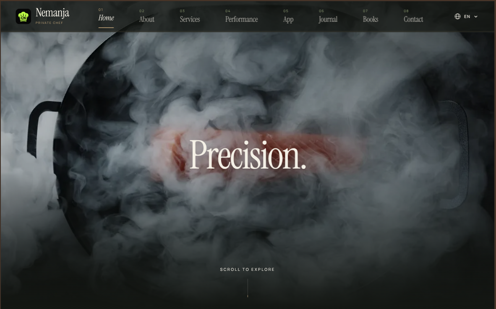
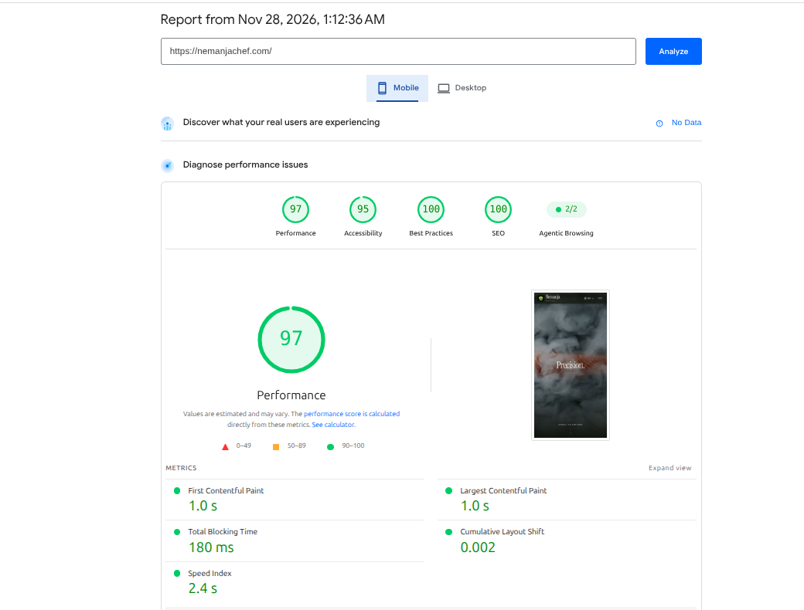
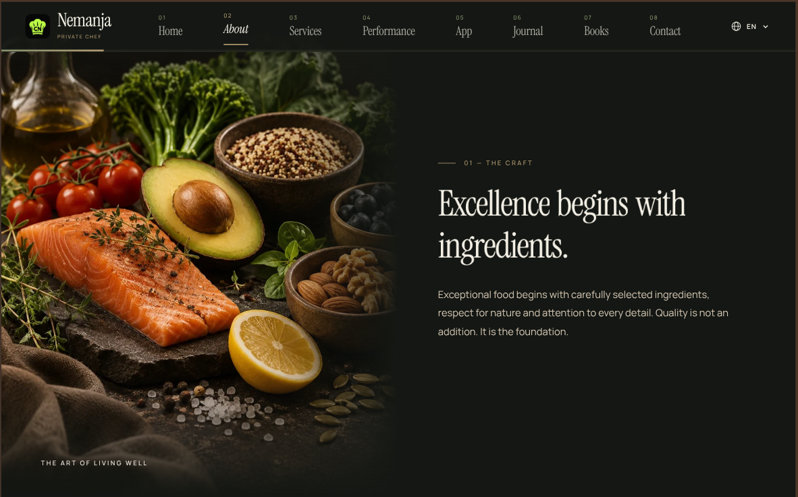
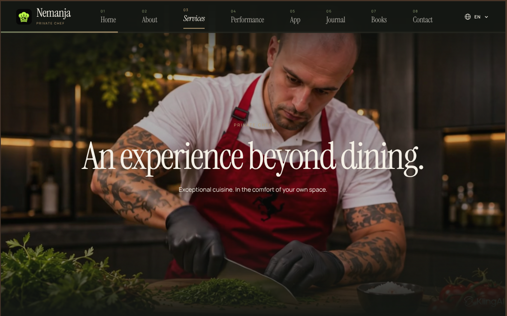
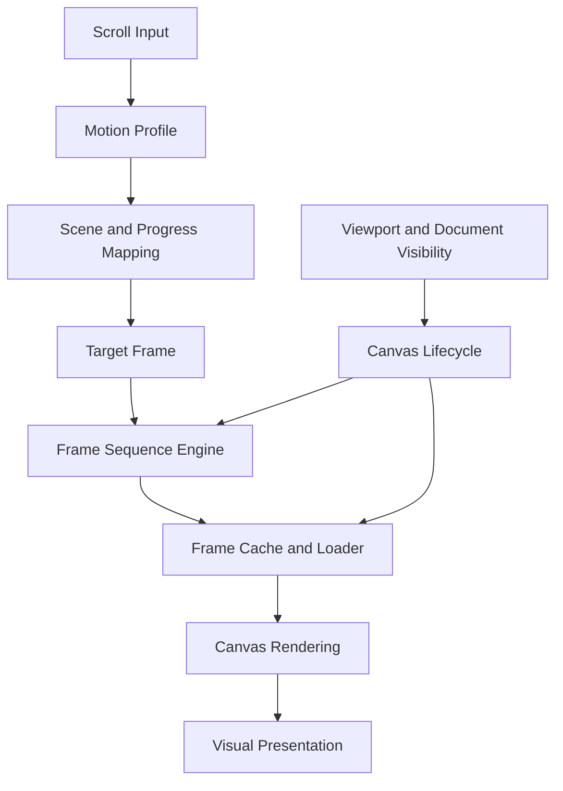

# Nemanja Chef — Cinematic Web Experience


A custom-built cinematic storytelling website for a private chef specializing in culinary wellness, personalized nutrition and athletic performance in Abu Dhabi.

An immersive digital experience combining scroll-driven visual narratives, custom canvas rendering, modular frontend architecture and performance engineering.

**Live website:** [nemanjachef.com](https://nemanjachef.com/)

**Designed & developed by:** [ZenCodeLab](https://zencodelab.dev/)



## Production Performance


The website underwent a dedicated performance engineering phase focused on critical rendering, JavaScript execution, animation lifecycle management and progressive asset delivery.

<p align="center">
  
  
</p>

### Lighthouse Results

| Metric | Desktop | Mobile |
|---|---:|---:|
| Performance | 100 | 97 |
| Accessibility | 96 | 95 |
| Best Practices | 100 | 100 |
| SEO | 100 | 100 |
| First Contentful Paint | 0.3 s | 1.0 s |
| Largest Contentful Paint | 0.3 s | 1.0 s |
| Total Blocking Time | 40 ms | 180 ms |
| Cumulative Layout Shift | 0.004 | 0.002 |
| Speed Index | 0.9 s | 2.4 s |

### Before & After Optimization

| Metric | Before | After | Improvement |
|---|---:|---:|---:|
| Desktop Performance | 66 | 100 | +34 points |
| Mobile Performance | 83 | 97 | +14 points |
| Desktop TBT | 1,000 ms | 40 ms | 96% reduction |
| Mobile TBT | 640 ms | 180 ms | 71.9% reduction |
| Desktop LCP | 0.4 s | 0.3 s | 25% reduction |
| Mobile LCP | 1.5 s | 1.0 s | 33.3% reduction |

These results were achieved without relying on dedicated WordPress performance or page-cache plugins.

[Run a live Google PageSpeed analysis](https://pagespeed.web.dev/analysis?url=https%3A%2F%2Fnemanjachef.com%2F)

> Results are based on individual production Lighthouse audits recorded on November 28, 2026. Laboratory scores may vary depending on device capabilities, network conditions and testing environments. They do not represent aggregated real-user performance data.

## Project Overview

Nemanja Chef was developed as a bespoke digital experience rather than a conventional template-based website.

The project combines editorial design, cinematic motion and interactive storytelling with a custom WordPress architecture.

The primary engineering challenge was delivering a visually rich, animation-intensive experience while maintaining responsive layouts, controlled resource consumption and fast initial rendering.

The frontend was built without visual page builders, using reusable Blade components, modular stylesheets and dedicated JavaScript animation modules.

## Visual Experience

<table>
  <tr>
    <td width="50%">
      
      <strong>Culinary Philosophy</strong>
    </td>
    <td width="50%">
      
      <strong>Cinematic Services</strong>
    </td>
  </tr>
  <tr>
    <td width="50%">
      
      <strong>Digital Publications</strong>
    </td>
    <td width="50%">
      
      <strong>Social Experience</strong>
    </td>
  </tr>
</table>

## Core Features

- Cinematic scroll-driven storytelling
- Custom HTML5 Canvas rendering engines
- Independent desktop and mobile image sequences
- Adaptive animation interpolation
- Direction-aware frame preloading
- Bounded frame caching and controlled concurrent loading
- Visibility-aware animation lifecycle management
- Scroll-controlled video playback
- Cinematic chapter navigation
- Responsive editorial layouts
- Multilingual content architecture
- Dedicated WooCommerce storefront foundation
- Custom SEO metadata and structured data

## Cinematic Animation Architecture

The cinematic experience is powered by a modular JavaScript architecture built around GSAP, ScrollTrigger, Lenis and custom frame sequence engines.

### Image Sequence Architecture

| Experience | Frames | Resolution | Rendering |
|---|---:|---:|---|
| Desktop Hero | 893 | 1280 × 720 | Canvas |
| Mobile Hero | 330 | 576 × 1024 | Canvas |
| Mobile Services | 121 | 576 × 1024 | Canvas |

The project contains 1,344 frames across its primary cinematic sequences.

Frames are loaded progressively according to the current animation position rather than downloading complete sequences during the initial page load.

### Hero Narrative

The hero experience is divided into five cinematic chapters:

1. Precision
2. Craft
3. Intention
4. Balance
5. Performance

Each chapter contributes to a continuous scroll-driven visual narrative.

Scene configuration is managed through sequence manifests, allowing frame ranges, scene weights, visual grading and motion behavior to be configured independently of the rendering engine.

### Desktop Experience

The desktop rendering engine integrates canvas-based image sequences with GSAP ScrollTrigger and Lenis smooth scrolling.

Scroll progress determines the active scene and target frame, while direction-aware preloading prepares nearby frames for subsequent interactions.

### Mobile Experience

The mobile experience uses dedicated portrait-oriented image sequences rather than simply resizing desktop assets.

Native touch scrolling, adaptive playhead damping, controlled canvas resolution and bounded image caches provide a device-specific rendering strategy.

### Services Experience

The Services section implements two separate rendering approaches:

- Desktop: scroll-controlled cinematic video.
- Mobile: dedicated canvas-based image sequence.

Non-critical media initialization is deferred until the section approaches the viewport.

## Animation Engine

| Module | Responsibility |
|---|---|
| `animation-engine.js` | Central animation initialization |
| `smooth-scroll.js` | Lenis smooth scrolling integration |
| `motion-profile.js` | Device-specific motion configuration |
| `frame-sequence.js` | Desktop image sequence rendering |
| `mobile-frame-sequence.js` | Mobile image sequence rendering |
| `services-frame-sequence.js` | Services cinematic rendering |
| `frame-store.js` | Frame loading, caching and request management |
| `damped-playhead.js` | Adaptive animation interpolation |
| `canvas-lifecycle.js` | Visibility-based animation lifecycle |
| `chapter-transition.js` | Cinematic chapter navigation |
| `section-transition.js` | Transitions between storytelling sections |
| `storytelling.js` | Secondary storytelling initialization |

### Rendering Pipeline



The animation system separates scroll input, scene mapping, frame selection, resource loading and visual presentation.

This separation allows individual components to be optimized without redesigning the entire storytelling experience.

## Performance Engineering

Performance optimization is implemented at the application, rendering and asset-delivery levels.

### Critical Rendering

- Responsive first-frame preloading
- High-priority hero image requests
- Prioritized hero initialization
- Dynamic imports for secondary storytelling modules
- Deferred non-critical media loading
- Independent storefront assets

### Runtime Optimization

- Removal of redundant ScrollTrigger refresh operations
- Visibility-aware canvas rendering
- Suspension of new frame loading outside active observation areas
- Animation suspension when the document becomes hidden
- Direction-aware frame request prioritization
- Bounded frame caches
- Controlled concurrent requests
- Reduced redundant presentation updates

### Asset Delivery

- Responsive WebP photography
- Optimized cinematic image sequences
- Compressed video assets
- Local WOFF2 typography
- Variable font support
- Vite-generated hashed production assets
- Long-term caching for immutable build resources
- Server-side compression

### WordPress Optimization

- Conditional frontend asset loading
- Removal of unnecessary WooCommerce assets from the storytelling homepage
- Modular theme functionality
- Separate storytelling and storefront presentation layers
- No dedicated performance or page-cache plugin dependency

## Technology Stack

| Layer | Technology |
|---|---|
| CMS | WordPress |
| Theme Framework | Roots Sage |
| Application Foundation | Roots Acorn |
| Backend | PHP 8.3 |
| Templating | Blade |
| Styling | Tailwind CSS 4, Modular CSS |
| Frontend | JavaScript ES Modules |
| Animation | GSAP, ScrollTrigger |
| Smooth Scrolling | Lenis |
| Rendering | HTML5 Canvas |
| Build System | Vite |
| Typography | Instrument Serif, Manrope Variable |
| Localization | Polylang |
| E-commerce | WooCommerce |
| Database | MariaDB |
| Development Environment | DDEV |
| Version Control | Git, GitHub |

## Project Structure

The custom theme is located in `web/wp-content/themes/nutrition/`.

```text
nutrition/
├── app/
│   ├── setup.php
│   ├── filters.php
│   ├── localization.php
│   ├── performance.php
│   ├── seo.php
│   └── shop.php
├── resources/
│   ├── css/
│   │   ├── components/
│   │   ├── sections/
│   │   └── shop/
│   ├── js/
│   │   ├── core/
│   │   ├── engines/
│   │   ├── sections/
│   │   ├── app.js
│   │   ├── home.js
│   │   └── storytelling.js
│   ├── images/
│   ├── videos/
│   └── views/
│       ├── layouts/
│       └── sections/
├── public/
│   ├── build/
│   └── storytelling/
├── functions.php
├── composer.json
├── package.json
└── vite.config.js
```

The structure above highlights the primary theme components rather than every file in the application.

## Multilingual Architecture

The website supports English and Serbian through Polylang and custom translation resources.

| Language | Production URL |
|---|---|
| English | [nemanjachef.com](https://nemanjachef.com/) |
| Serbian | [nemanjachef.com/sr/](https://nemanjachef.com/sr/) |

Both language versions share the same presentation and animation architecture.

Localization is separated from visual components to avoid maintaining duplicate frontend implementations.

## SEO & Discoverability

The theme includes a custom SEO implementation covering:

- Localized page titles and meta descriptions
- Canonical URLs
- Multilingual hreflang integration
- Open Graph metadata
- Twitter Card metadata
- JSON-LD structured data
- Social sharing imagery
- Optimized favicon assets

## Nemanja Editions

The project includes a dedicated WooCommerce foundation for digital culinary publications.

The storefront has its own visual identity, templates, styling and animation modules.

Its architecture separates the editorial storytelling experience from transactional functionality and avoids loading unnecessary storefront assets on the main homepage.

The storefront is currently in pre-launch mode.

## Local Development

### Requirements

- Docker
- DDEV
- PHP 8.3
- Composer
- Node.js 22
- npm

### Clone the Repository

```bash
git clone https://github.com/MajaMica/nutrition-site.git
cd nutrition-site
ddev start
```

### Install Theme Dependencies

```bash
ddev exec --dir /var/www/html/web/wp-content/themes/nutrition composer install

ddev exec --dir /var/www/html/web/wp-content/themes/nutrition npm install
```

### Production Build

```bash
ddev exec --dir /var/www/html/web/wp-content/themes/nutrition npm run build

ddev wp acorn optimize:clear
```

### Environment Configuration

A configured WordPress installation, database, required plugins and cinematic media assets are necessary to reproduce the complete production experience.

Large production image sequences, database credentials and environment-specific configuration are not included in the repository.

The repository documents the application architecture and is not intended to be a standalone, one-click reproduction of the production website.

## Engineering Principles

- Modular and maintainable application architecture
- Separation of rendering and resource management
- Device-specific rendering strategies
- Progressive asset delivery
- Performance-conscious motion design
- Minimal unnecessary dependencies
- Reusable presentation components
- Production-oriented development

## Project Status

| Component | Status |
|---|---|
| Cinematic storytelling website | Production |
| Desktop experience | Implemented |
| Mobile experience | Implemented |
| Multilingual architecture | Implemented |
| Performance optimization | Implemented |
| Custom SEO | Implemented |
| Digital storefront | Pre-launch |

## Developer

**ZenCodeLab**

Custom web development, full-stack engineering, frontend architecture and performance-driven digital experiences.

- [Portfolio](https://zencodelab.dev/)
- [GitHub](https://github.com/MajaMica)
- [Live Project](https://nemanjachef.com/)

## Copyright & Usage

Client branding, photography, culinary content and associated media remain subject to their respective ownership and usage rights.

The presence of source code or visual materials in this repository does not imply unrestricted permission to reuse client assets.
