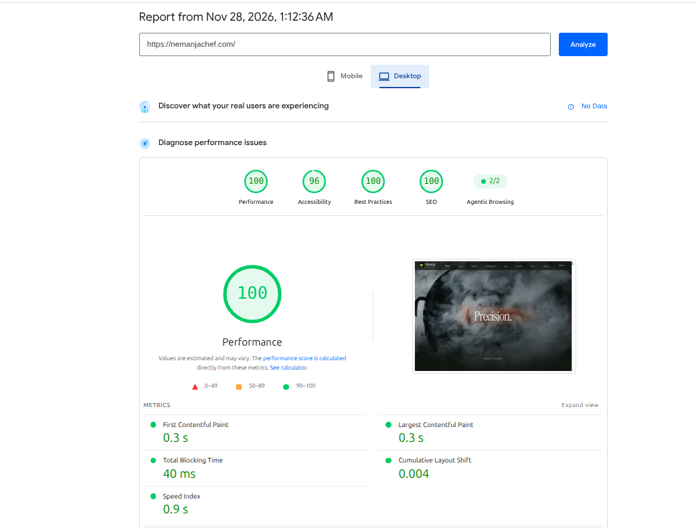
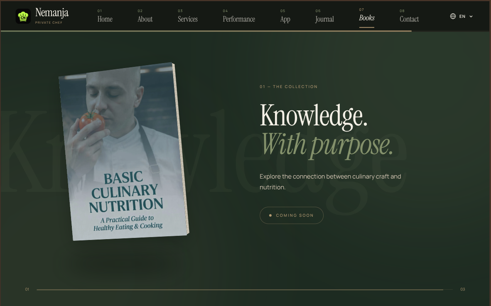
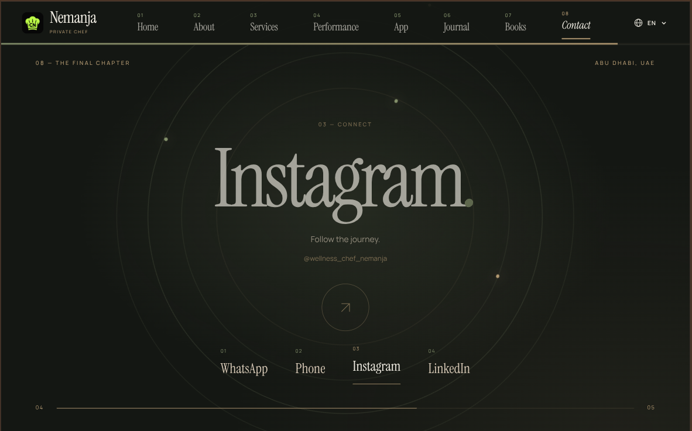
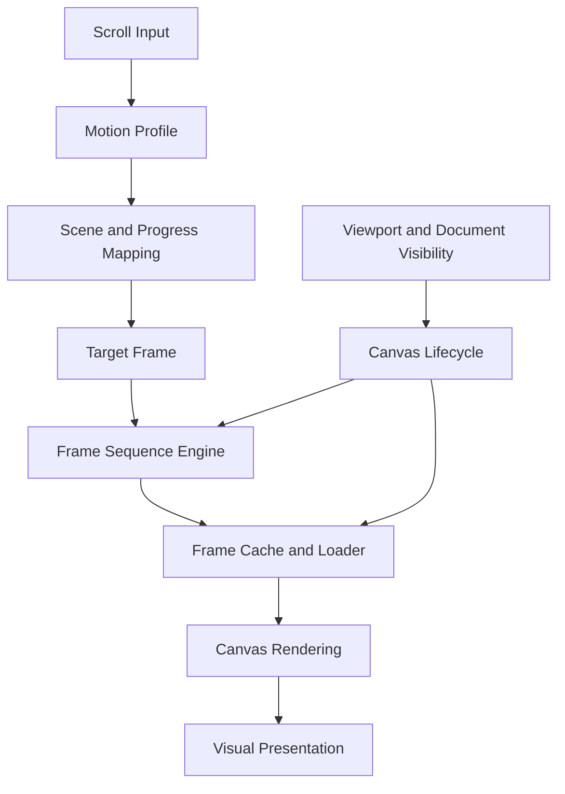

# Nemanja Chef — Cinematic Web Experience


A custom WordPress website for a private chef in Abu Dhabi, designed and developed from scratch with Roots Sage. The homepage uses scroll-driven Canvas image sequences and video, with separate desktop and mobile implementations.

The main technical challenge was keeping the animation responsive without loading hundreds of frames upfront or allowing decoded images to accumulate in memory. The theme uses Blade templates, Tailwind CSS and JavaScript modules rather than a visual page builder.

**Live website:** [nemanjachef.com](https://nemanjachef.com/)

**Designed & developed by:** [ZenCodeLab](https://zencodelab.dev/)


## Production Performance


These are the final production results from the November 28, 2026 Lighthouse audits. During development, I focused on getting the first hero frame on screen early, reducing main-thread work and limiting animation activity outside the visible area.

<p align="center">
  
  
</p>

### Lighthouse Results

| Metric | Desktop | Mobile |
|---|---:|---:|
| Performance | 100 | 97 |
| Accessibility | 96 | 95 |
| Best Practices | 100 | 100 |
| SEO | 100 | 100 |
| First Contentful Paint | 0.3 s | 1.0 s |
| Largest Contentful Paint | 0.3 s | 1.0 s |
| Total Blocking Time | 40 ms | 180 ms |
| Cumulative Layout Shift | 0.004 | 0.002 |
| Speed Index | 0.9 s | 2.4 s |

These results were achieved without relying on dedicated WordPress performance or page-cache plugins.

[Run a live Google PageSpeed analysis](https://pagespeed.web.dev/analysis?url=https%3A%2F%2Fnemanjachef.com%2F)

> Results are based on individual production Lighthouse audits recorded on November 28, 2026. Laboratory scores may vary depending on device capabilities, network conditions and testing environments. They do not represent aggregated real-user performance data.

## Visual Experience

<table>
  <tr>
    <td width="50%">
      
      <strong>Culinary Philosophy</strong>
    </td>
    <td width="50%">
      
      <strong>Cinematic Services</strong>
    </td>
  </tr>
  <tr>
    <td width="50%">
      
      <strong>Digital Publications</strong>
    </td>
    <td width="50%">
      
      <strong>Social Experience</strong>
    </td>
  </tr>
</table>

## Cinematic Animation Architecture

GSAP ScrollTrigger maps scroll progress to the animation timeline. Lenis handles smooth scrolling on desktop, while the custom sequence engines handle frame selection and Canvas rendering. Frame loading and caching are kept separate from the renderer so that scroll updates do not have to manage network requests directly.

### Image Sequence Architecture

| Experience | Frames | Resolution | Rendering |
|---|---:|---:|---|
| Desktop Hero | 893 | 1280 × 720 | Canvas |
| Mobile Hero | 330 | 576 × 1024 | Canvas |
| Mobile Services | 121 | 576 × 1024 | Canvas |

There are 1,344 frames in total. Loading the full sequences at startup would delay the first render and increase memory pressure, particularly on mobile. Instead, `frame-store.js` prioritizes frames near the current playhead, accounts for scroll direction and limits both the cache and concurrent requests.

### Hero Narrative

The hero experience is divided into five cinematic chapters:

1. Precision
2. Craft
3. Intention
4. Balance
5. Performance

Sequence manifests define frame ranges, scene weights, visual grading and motion settings. This keeps chapter timing and composition separate from the rendering code, so changing a scene does not require rewriting the engine.

### Desktop Experience

On desktop, scroll progress selects the active scene and target frame. The renderer updates in response to animation and frame availability rather than maintaining a continuous rendering loop while idle. Direction-aware loading prepares nearby frames as the user scrolls.

### Mobile Experience

Mobile uses separately composed portrait sequences rather than cropping the desktop footage. This preserves the composition and allows a smaller frame resolution. Native touch scrolling, adaptive playhead damping and bounded caches are used to accommodate mobile input and resource constraints.

### Services Experience

The Services section implements two separate rendering approaches:

- Desktop: scroll-controlled cinematic video.
- Mobile: dedicated canvas-based image sequence.

The mobile sequence gives the renderer direct control over frame selection instead of depending on video seeking during touch scrolling. Non-critical media initialization is deferred until the section approaches the viewport.

## Animation Engine

| Module | Responsibility |
|---|---|
| `animation-engine.js` | Central animation initialization |
| `smooth-scroll.js` | Lenis smooth scrolling integration |
| `motion-profile.js` | Device-specific motion configuration |
| `frame-sequence.js` | Desktop image sequence rendering |
| `mobile-frame-sequence.js` | Mobile image sequence rendering |
| `services-frame-sequence.js` | Services cinematic rendering |
| `frame-store.js` | Frame loading, caching and request management |
| `damped-playhead.js` | Adaptive animation interpolation |
| `canvas-lifecycle.js` | Visibility-based animation lifecycle |
| `chapter-transition.js` | Cinematic chapter navigation |
| `section-transition.js` | Transitions between storytelling sections |
| `storytelling.js` | Secondary storytelling initialization |

### Rendering Pipeline



`damped-playhead.js` handles interpolation between the current and target positions. `frame-store.js` manages requests and cached frames, while the sequence engines decide what to draw. `canvas-lifecycle.js` coordinates mobile rendering and new frame requests with viewport proximity and document visibility.

## Performance Engineering

### Initial load

The first hero frame is preloaded according to the viewport. Hero initialization takes priority over secondary storytelling modules, which are loaded through dynamic imports. Services media is deferred until it is needed. ScrollTrigger refresh calls were reduced during development, while retaining the refreshes needed for layout and chapter navigation.

### Runtime

The mobile hero and Services engines suspend their animation loops and pause new frame loading when their sections are outside the observation area or the document is hidden. On reactivation, the engines resume from the current scroll state. Redundant presentation updates are skipped, and frame requests are prioritized according to the playhead and scroll direction.

### Assets and WordPress

Photography uses responsive WebP variants, cinematic sequences and video are compressed, and fonts are served locally as WOFF2. Vite generates hashed production assets that can be cached long-term; server-side compression is also enabled.

The storytelling homepage does not need WooCommerce's frontend assets. `app/performance.php` removes unnecessary assets conditionally, leaving the storefront with its own presentation and asset loading. No dedicated WordPress performance or page-cache plugin is required for the reported results.

## Technology Stack

| Layer | Technology |
|---|---|
| CMS | WordPress |
| Theme Framework | Roots Sage |
| Application Foundation | Roots Acorn |
| Backend | PHP 8.4 (production), PHP 8.3 (local DDEV) |
| Templating | Blade |
| Styling | Tailwind CSS 4, Modular CSS |
| Frontend | JavaScript ES Modules |
| Animation | GSAP, ScrollTrigger |
| Smooth Scrolling | Lenis |
| Rendering | HTML5 Canvas |
| Build System | Vite |
| Typography | Instrument Serif, Manrope Variable |
| Localization | Polylang |
| E-commerce | WooCommerce |
| Database | MariaDB |
| Development Environment | DDEV |
| Version Control | Git, GitHub |

## Project Structure

The custom theme is located in `web/wp-content/themes/nutrition/`.

```text
nutrition/
├── app/
│   ├── setup.php
│   ├── filters.php
│   ├── localization.php
│   ├── performance.php
│   ├── seo.php
│   └── shop.php
├── resources/
│   ├── css/
│   │   ├── components/
│   │   ├── sections/
│   │   └── shop/
│   ├── js/
│   │   ├── core/
│   │   ├── engines/
│   │   ├── sections/
│   │   ├── app.js
│   │   ├── home.js
│   │   └── storytelling.js
│   ├── images/
│   ├── videos/
│   └── views/
│       ├── layouts/
│       └── sections/
├── public/
│   ├── build/
│   └── storytelling/
├── functions.php
├── composer.json
├── package.json
└── vite.config.js
```

The structure above highlights the primary theme components rather than every file in the application.

## Multilingual Architecture

English and Serbian are managed through Polylang and custom translation resources.

| Language | Production URL |
|---|---|
| English | [nemanjachef.com](https://nemanjachef.com/) |
| Serbian | [nemanjachef.com/sr/](https://nemanjachef.com/sr/) |

Both languages use the same Blade components and animation modules. Translation resources are kept separate so that layout and animation changes do not need to be implemented twice.

## SEO & Discoverability

The theme includes a custom SEO implementation covering:

- Localized page titles and meta descriptions
- Canonical URLs
- Multilingual hreflang integration
- Open Graph metadata
- Twitter Card metadata
- JSON-LD structured data
- Social sharing imagery
- Optimized favicon assets

## Nemanja Editions

The theme includes a separate WooCommerce storefront for planned digital culinary publications. It has its own templates, styles and animation modules, keeping transactional functionality separate from the storytelling homepage.

The storefront is in pre-launch mode; the live editorial website is in production.

## Local Development

### Requirements

- Docker
- DDEV
- PHP 8.3 (current DDEV configuration; production runs PHP 8.4)
- Composer
- Node.js 22
- npm

### Clone the Repository

```bash
git clone https://github.com/MajaMica/nutrition-site.git
cd nutrition-site
ddev start
```

### Install Theme Dependencies

```bash
ddev exec --dir /var/www/html/web/wp-content/themes/nutrition composer install

ddev exec --dir /var/www/html/web/wp-content/themes/nutrition npm install
```

### Production Build

```bash
ddev exec --dir /var/www/html/web/wp-content/themes/nutrition npm run build

ddev wp acorn optimize:clear
```

### Environment Configuration

A configured WordPress installation, database, required plugins and cinematic media assets are necessary to reproduce the complete production experience.

Large production image sequences, database credentials and environment-specific configuration are not included in the repository.

The repository documents the application architecture and is not intended to be a standalone, one-click reproduction of the production website.

## Developer

**ZenCodeLab**

- [Portfolio](https://zencodelab.dev/)
- [GitHub](https://github.com/MajaMica)
- [Live Project](https://nemanjachef.com/)

## Copyright & Usage

Client branding, photography, culinary content and associated media remain subject to their respective ownership and usage rights.

The presence of source code or visual materials in this repository does not imply unrestricted permission to reuse client assets.
